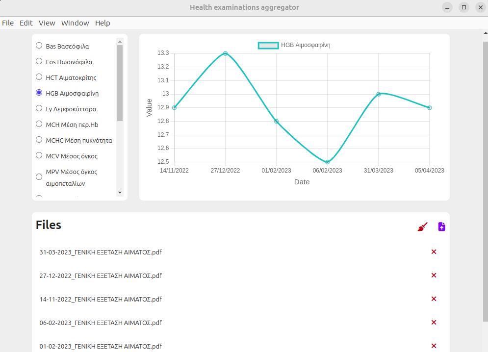

# PAGNI-medical-tests-aggregator

In a short period of time I had the "pleasure" to visit many and **different** doctors in the hospital PAGNI. Each visit consisted of a new blood test. So, each doctor had to examine the huge load of those blood tests in order to track the history of my health condition. The more the tests, the more difficult for the new doctor (but also me) to accurately grasp a clear picture of my health.

This desktop app aims to support doctors to track the progress of multiple blood tests' results across time, in an intuitive and usable way. Using this app, even the patients themselves could have a better understanding of their health condition.



`PAGNI-medical-tests-aggregator` app:

1. parses multiple blood test files (PDF format) with the specific format defined by the hospital PAGNI
2. groups extracted health data by medical test (i.e. HCT, MCHC)
3. visualizes the progress of each medical test across time with charts

**Privacy-first:** all parsing and storage happen locally on your machine. The app makes no network calls and sends nothing anywhere.

## Terminology

- **Medical report**: a file which contains many medical tests and their corresponding results.
- **Medical test**: e.g. the C-reactive protein (CRP) test.
- **Medical test result**: e.g. the value `0.75 mg/L` for test CRP.

## Tech stack

- **Shell**: [Tauri 2](https://tauri.app/) (Rust core + system WebView) — small bundles, low memory footprint
- **Backend**: Rust — `pdf-extract` (PDF text), regex parser, `tauri-plugin-store` (local persistence)
- **Frontend**: Vue 3.5 (Composition API) + Tailwind CSS 4 + Chart.js 4
- **State**: Pinia
- **Build**: Vite 8
- **Tests**: Vitest + @vue/test-utils (frontend), `cargo test` (Rust)

## Prerequisites

- [Node.js](https://nodejs.org/) 20+ and [pnpm](https://pnpm.io/)
- [Rust](https://rustup.rs/) toolchain
- **Linux only**, system dependencies for the WebView:

  ```bash
  sudo apt-get update && sudo apt-get install -y \
    build-essential libwebkit2gtk-4.1-dev libssl-dev libgtk-3-dev \
    libayatana-appindicator3-dev librsvg2-dev curl wget file
  ```

  See the [Tauri prerequisites](https://tauri.app/start/prerequisites/) for other platforms.

## Develop

```bash
pnpm install
pnpm tauri dev
```

## Test

```bash
pnpm test            # frontend unit/component tests (Vitest)
pnpm test:coverage   # with coverage gates
pnpm test:rust       # Rust unit tests (cargo test)
```

## Build

```bash
pnpm tauri build     # produces platform bundles (AppImage/deb, dmg, nsis)
```

## History

The previous Electron + Vuetify + Jest version is preserved at the git tag `v1.0.0-electron`.
